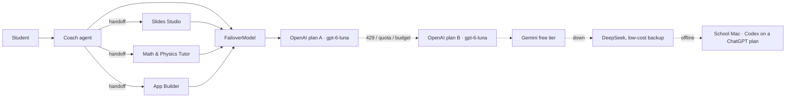

# SpecWithCode Classroom

**Free AI study help that never runs out.** A simplified, free-model edition of [SpecWithCode](https://specwithcode.com) for K-12 schools. It pools a school's donated, free and low-cost AI subscriptions and machines into one Key Ring, switches automatically when one runs out mid-class, and helps students learn instead of doing the work for them: it coaches them through slide decks, math and physics problems, and websites or apps they build themselves. Teachers use it to make quizzes with answer keys and to check student answers.

Built at the DevDay Exchange Community Hackathon: Miami (November 7 and 8, 2026), for South Florida K-12 schools and the nonprofits that support them.

> **Built with OpenAI.** SpecWithCode Classroom runs on the **OpenAI Agents SDK** (agents, handoffs, tools, input guardrails, tracing), uses the **OpenAI API** (Responses API, `gpt-6-luna`) as the first providers on the Key Ring, one per OpenAI plan the school holds, and was built with **Codex** (the test suite in `tests/` was written by Codex). This covers the hackathon's three acceptance criteria. Other providers plug into the same Agents SDK model interface.

**Live demo:** https://specwithcode-classroom.vercel.app · **Video (narrated):** https://www.youtube.com/watch?v=tudzrDLYe78 · **Pitch deck:** [PDF](docs/pitch/SpecWithCode-Classroom-pitch.pdf), [PowerPoint](docs/pitch/SpecWithCode-Classroom-pitch.pptx)


## The story

Maya is in 7th grade at a Miami K-8 school. Her class uses free AI tools every day, and every day the free tier runs out around third period. Families who can pay keep going; Maya's class stops.

Her school already has more AI capacity than it uses: several OpenAI plans with GPT-6 Luna credits (a nonprofit grant, a PTA plan, a teacher's donated plan), a Gemini free tier on the district account, a low-cost DeepSeek plan as a backup, and a library Mac signed in to Codex on a ChatGPT plan. They just live in four places, with four logins, and nobody switches between them in the middle of a lesson.

SpecWithCode Classroom is the one door in front of all of them. Maya asks for a presentation on volcanoes, a projectile problem, or an app for her book club. Coach routes the job to the right specialist agent, and the Key Ring routes every model call to whichever subscription still has tokens. When OpenAI plan A hits its daily cap at 10:40, the next call goes to plan B, then Gemini, then DeepSeek, then the library Mac, and Maya never sees an error. Families are billed $0.

## Why it's called SpecWithCode

Students learn more from a plain answer when they decide what "done" means and check it themselves. Every request runs the same loop:

1. **Spec.** The specialist writes the goal and a short "done when" checklist the student can verify.
2. **Code.** Then the work: slides, a worked solution, or a real app, built against that checklist.
3. **Check.** The student ticks off each item. In **Learn** mode (the default) the last step is theirs: the tutor stops before the final step, the app builder leaves one criterion as a `// YOUR TURN` with hints, and speaker notes become prompts instead of a script.

## Machines: Codex on a ChatGPT plan

Any computer signed in to Codex can join the ring. `machine/codex_bridge.py` serves the Chat Completions protocol and answers each call with `codex exec -m gpt-6-luna`, so the work is billed to that computer's ChatGPT plan rather than API credits. Tool calls come back as structured output, so handoffs and tools keep working.

```bash
SWC_MACHINE_KEY=<shared secret> .venv/bin/python machine/codex_bridge.py   # on the machine
cloudflared tunnel --url http://127.0.0.1:8790                             # expose it
SWC_MACHINES="Library Mac=https://<tunnel>/v1;Room 204=https://<tunnel2>/v1" # on the server, with the same SWC_MACHINE_KEY
```

Add as many machines as you like, separated by `;`. Each one appears as its own card on the ring.

## Proof it runs on real tokens

The **Usage log** records every model call this browser made: time, request, provider, model, tokens in and out, time taken, and the provider's receipt (an OpenAI `resp_…` id). **Check with OpenAI** calls `GET /v1/responses/{id}` through `/api/verify/...` and shows the model and token counts as OpenAI reports them. **Trace** opens the Agents SDK trace for the run in the OpenAI dashboard. The log can be exported as CSV. **Refill all** only undoes simulated outages; it never erases usage.

## What it does

| Specialist | Output |
| --- | --- |
| Slides Studio | A 5 to 7 slide deck with speaker notes, shown in the browser and downloadable as `.pptx` |
| Math & Physics Tutor | Step-by-step solutions in LaTeX, every result checked with SymPy before it is stated, plus a "check yourself" question |
| App Builder | Spec first, then code, the SpecWithCode way: a one-page spec (goal, acceptance criteria, tasks), then a complete single-file website or mobile web app, previewed in a phone frame and downloadable |
| Coach | Triage and short study answers; hands off to the specialists |

Teachers pick **Learn** (hints and steps, the student does the last step) or **Finish** (complete work, explained so the student can defend it). A K-12 safety guardrail screens every request.

## How the Key Ring works



`FailoverModel` (`swc_classroom/router.py`) implements the Agents SDK `Model` interface. OpenAI plans run through the SDK's `OpenAIResponsesModel`; Gemini, DeepSeek and school machines speak Chat Completions and run through `OpenAIChatCompletionsModel`. When a run moves between providers, reasoning items are dropped so the next provider gets a clean transcript. On each model call the ring tries providers in the school's policy order and moves on when one returns 429, 402, 401/403, 5xx, a connection error, or has used its school-set daily token budget. A provider that fails stays skipped for the rest of that run. Every hop is returned to the UI, which shows it as a route trail on each answer and updates the budget bars.

Because the switch happens per model call, not per conversation, a single task can start on one subscription and finish on another, including mid-handoff.

## Run it

```bash
python3 -m venv .venv && .venv/bin/pip install -r requirements.txt
cp .env.example .env   # add the keys you have; missing providers show as offline
.venv/bin/uvicorn swc_classroom.app:app --port 8765
open http://127.0.0.1:8765
```

Tests (offline, no keys needed):

```bash
.venv/bin/pip install -r requirements-dev.txt
.venv/bin/python -m pytest -q
```

Headless walkthrough that regenerates the screenshots in `docs/`: `.venv/bin/python scripts/screens.py`.

### Configuration

| Variable | Purpose |
| --- | --- |
| `OPENAI_API_KEY`, `OPENAI_API_KEY_2` … `_9` | One provider per OpenAI plan; the first also exports Agents SDK traces |
| `OPENAI_LABEL_n` | Display name per plan, e.g. `PTA plan` |
| `DEEPSEEK_API_KEY` | DeepSeek provider |
| `GEMINI_API_KEY` | Gemini free-tier provider (OpenAI-compatible endpoint) |
| `SWC_MACHINE_KEY` | Shared secret between the server and machine bridges |
| `SWC_MACHINES` | School machines (Codex bridge, Ollama or LM Studio): `Library Mac=http://lib-mac.local:11434/v1;Room 204=http://10.0.0.24:11434/v1` |
| `SWC_*_MODEL` | Override the model per provider |
| `SWC_*_BUDGET` | Daily token budget per provider |

### Deploy

Live on Vercel (`vercel.json` deploys the FastAPI app as one Python function; set the keys as environment variables and run `vercel deploy --prod`). Any container host also works with the included `Dockerfile` (for example `gcloud run deploy specwithcode-classroom --source .` with the keys as environment variables).

## Layout

```
swc_classroom/router.py   Key Ring, providers, FailoverModel
swc_classroom/team.py     Agents: Coach, Slides Studio, Tutor, App Builder, safety guardrail
swc_classroom/slides.py   Deck to .pptx
swc_classroom/app.py      FastAPI API and static UI
static/              Frontend (HTML, CSS, JS, KaTeX, marked)
tests/               Offline tests for failover and slides
```

## Limits and next steps

Usage counters are in memory per server process; a school deployment would keep them in a small database. Consumer chat subscriptions (for example a student's ChatGPT Free account) cannot be pooled through an API, so the Key Ring uses API keys and machines the school controls. Next: per-class budgets set by teachers, Google Classroom sign-in, and an offline mode that runs entirely on the lab machine.

## License

MIT
