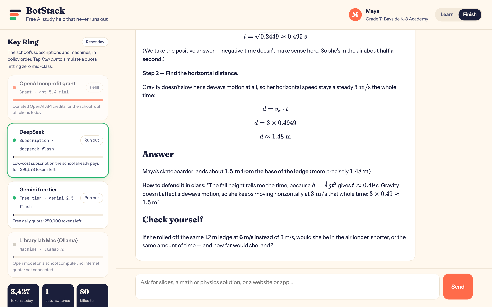
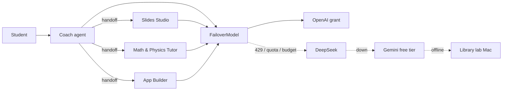

# BotStack

**Free AI study help that never runs out.** BotStack pools a school's donated, free and low-cost AI subscriptions and machines into one Key Ring, switches automatically when one runs out mid-class, and finishes real schoolwork: slide decks, math and physics solutions, and websites or mobile apps students build themselves.

Built at the DevDay Exchange Community Hackathon: Miami (November 7 and 8, 2026), for South Florida K-12 schools and the nonprofits that support them.

> **Built with OpenAI.** BotStack runs on the **OpenAI Agents SDK** (agents, handoffs, tools, input guardrails, tracing), uses the **OpenAI API** as the first provider on the Key Ring (`gpt-5.4-mini` on donated nonprofit credits), and was built with **Codex** (the test suite in `tests/` was written by Codex). This covers the hackathon's three acceptance criteria. Other providers plug into the same Agents SDK model interface.



## The story

Maya is in 7th grade at a Miami K-8 school. Her class uses free AI tools every day, and every day the free tier runs out around third period. Families who can pay keep going; Maya's class stops.

Her school already has more AI capacity than it uses: a nonprofit OpenAI credit grant, a cheap DeepSeek subscription, a Gemini free tier on the district account, and a Mac in the library that can run an open model. They just live in four places, with four logins, and nobody switches between them in the middle of a lesson.

BotStack is the one door in front of all of them. Maya asks for a presentation on volcanoes, a projectile problem, or an app for her book club. Coach routes the job to the right specialist agent, and the Key Ring routes every model call to whichever subscription still has tokens. When the OpenAI grant hits its daily cap at 10:40, the next call goes to DeepSeek and Maya never sees an error. Families are billed $0.

## What it does

| Specialist | Output |
| --- | --- |
| Slides Studio | A 5 to 7 slide deck with speaker notes, shown in the browser and downloadable as `.pptx` |
| Math & Physics Tutor | Step-by-step solutions in LaTeX, every result checked with SymPy before it is stated, plus a "check yourself" question |
| App Builder | A complete single-file website or mobile web app, previewed in a phone frame and downloadable |
| Coach | Triage and short study answers; hands off to the specialists |

Teachers pick **Learn** (hints and steps, the student does the last step) or **Finish** (complete work, explained so the student can defend it). A K-12 safety guardrail screens every request.

## How the Key Ring works



`FailoverModel` (`botstack/router.py`) implements the Agents SDK `Model` interface. Every provider speaks the Chat Completions protocol and is wrapped in `OpenAIChatCompletionsModel`. On each model call the ring tries providers in the school's policy order and moves on when one returns 429, 402, 401/403, 5xx, a connection error, or has used its school-set daily token budget. A provider that fails stays skipped for the rest of that run. Every hop is returned to the UI, which shows it as a route trail on each answer and updates the budget bars.

Because the switch happens per model call, not per conversation, a single task can start on one subscription and finish on another, including mid-handoff.

## Run it

```bash
python3 -m venv .venv && .venv/bin/pip install -r requirements.txt
cp .env.example .env   # add the keys you have; missing providers show as offline
.venv/bin/uvicorn botstack.app:app --port 8765
open http://127.0.0.1:8765
```

Tests (offline, no keys needed):

```bash
.venv/bin/pip install -r requirements-dev.txt
.venv/bin/python -m pytest -q
```

Headless walkthrough that regenerates the screenshots in `docs/`: `.venv/bin/python scripts/screens.py`.

### Configuration

| Variable | Purpose |
| --- | --- |
| `OPENAI_API_KEY` | OpenAI provider, and Agents SDK trace export |
| `DEEPSEEK_API_KEY` | DeepSeek provider |
| `GEMINI_API_KEY` | Gemini free-tier provider (OpenAI-compatible endpoint) |
| `BOTSTACK_LAB_URL` | A school machine running Ollama, e.g. `http://lab-mac.local:11434/v1` |
| `BOTSTACK_*_MODEL` | Override the model per provider |
| `BOTSTACK_*_BUDGET` | Daily token budget per provider |

### Deploy

`vercel.json` deploys the FastAPI app as one Python function. Set the keys above as Vercel environment variables and run `vercel deploy --prod`.

## Layout

```
botstack/router.py   Key Ring, providers, FailoverModel
botstack/team.py     Agents: Coach, Slides Studio, Tutor, App Builder, safety guardrail
botstack/slides.py   Deck to .pptx
botstack/app.py      FastAPI API and static UI
static/              Frontend (HTML, CSS, JS, KaTeX, marked)
tests/               Offline tests for failover and slides
```

## Limits and next steps

Usage counters are in memory per server process; a school deployment would keep them in a small database. Consumer chat subscriptions (for example a student's ChatGPT Free account) cannot be pooled through an API, so the Key Ring uses API keys and machines the school controls. Next: per-class budgets set by teachers, Google Classroom sign-in, and an offline mode that runs entirely on the lab machine.

## License

MIT
